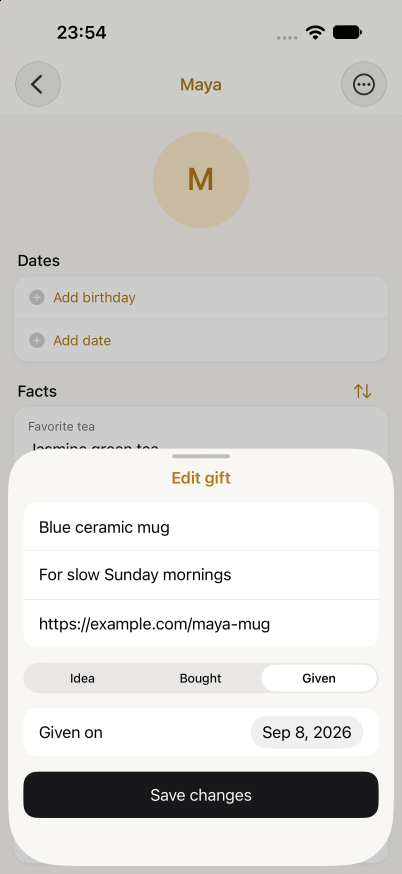
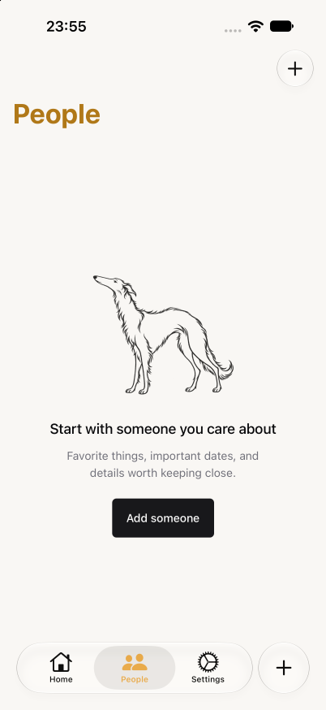

# E2E adoption verification — 2026-10-15

The repository-owned lifecycle suite passed three consecutive fresh-install runs
on the existing iPhone 18 Pro / iOS 27 simulator, with zero retries. A temporary
production-source fault then failed the intended assertion; restoring the exact
source bytes made the unchanged suite pass again. The compact
[measured evidence](e2e-adoption-2026-10-15.json) includes run IDs, timestamps,
counts, durations, teardown results, source/test hashes and the exact fault error.

A compatibility run of the unchanged suite also passed on the existing iPhone 16 /
iOS 18 simulator in 80.83 seconds. After the Mac connection recovered, source/test
hashes and completed fault-run cleanup were independently rechecked. Final ownership
checks found no owned runner/Metro process, no listener on port 8092, no temporary
keep-awake process, and both baseline simulators shut down. The disposable app was
removed with no cleanup errors. No permanent power settings were changed.

## Baseline and scope

Started from freshly fetched `origin/master` at
`8ba1295b6299e106165a39c79321d3cfcb54055b`, after verifying PRs #43 and #44 were
merged. The primary checkout's existing edits were preserved in place; all work
used the isolated `codex/e2e-integration` worktree. TestFlight availability was
user-reported, not independently verified or changed.

A fresh local prebuild, CocoaPods install and Xcode simulator Debug build succeeded
using the current native dependencies. The harness copied and signed that binary
under the disposable `com.rogeonee.lapsha.e2e` identity and served this worktree's
JavaScript through its own Metro. This is development-client evidence, not release,
OTA, offline, store or distribution verification.

The native journey cancels an unsaved person, creates a person/fact/Given gift,
selects the previous month's day 8, relaunches and checks exact Expo SQLite rows,
cancels person deletion, discards a change to day 9, reopens the saved editor, then
confirms gift/person deletion and checks tombstones after relaunch. It uses named
accessibility nodes and measured native geometry, without fixed screen pixels,
October-specific dates, service seeding or a model judging success.





## Failure detection

In an exclusively owned checkout, the `createGift` selected/default date expression
was temporarily replaced by `'2000-01-01'`. The unchanged native test failed after
relaunch at `persistence-contract.ts` with:

```text
Given date must remain the selected civil date after relaunch/cancel
actual:   2000-01-01
expected: 2026-09-08
```

This was a production persistence fault, not a locator/setup failure. A `finally`
path restored the original service bytes. Original and restored SHA-256 both equal
`645800212c61256473243e3b4eb3fe760331c07b7234ca0cc83b1740f5567484`.
All six native TypeScript files had identical hashes before and after the experiment.
The restored run passed in 115.51 seconds. No mutation is committed.

## Host coverage and calibration

`bun run check` passed. `bun run test` passed 102 tests across 17 files;
`bun run test:timezones` passed 52 tests in each of Edmonton and Tokyo. The four
new integration cases exercise disk-backed production services across fresh
processes, a writer terminated after commit, exact calendar values in three time
zones, soft deletion, and migration rollback/reopen/retry. Native module boundaries
are mocked in those host tests; the iOS journey separately exercises Expo SQLite.

Calibration exposed a missing iOS People-row accessibility frame after cold launch,
a swipe partly behind the tab bar, duplicate system popover dismissal nodes, and
an iOS 27 uninstall-registration flush delay. These were fixed before the final
three-run sequence. The People row now has a real accessible container while
retaining its native preview link. Actual VoiceOver use and long-press preview
behavior are not claimed as verified.

The harness rejects skipped/empty reports, refuses an existing test identity or
occupied port, records process ownership, removes only its clone, and requires
sustained registry absence before shutting down a simulator it booted. Independent
review cleared the integration and cleanup implementation. An orphan-process cleanup
check and invalid-report checks also passed during development.

## Reproduction and limits

See [TESTING.md](../../TESTING.md) for build prerequisites, commands and the mutation
procedure. The measured iOS 27 command was:

```sh
python3 e2e/run-ios.py \
  --app .e2e-build/Build/Products/Debug-iphonesimulator/Lapsha.app \
  --device CA556E39-5624-40F3-A0CA-639E027F5C2C --runs 3
```

Full local reports/traces/logs remain under ignored `e2e/artifacts/clean-stable/`
and `e2e/artifacts/fault-20261015T055856.846852Z/`; the JSON above preserves portable
summary evidence. These paths are local artifacts, not files expected in a clone.

The existing EAS quality workflow includes the integration cases through `bun run
test`; native iOS is not a remote CI gate. Android, physical devices, photo/camera
flows, real midnight/background transitions, text-size/locale matrices and remote
macOS CI remain unverified. Existing useful tests outside this slice are retained.
