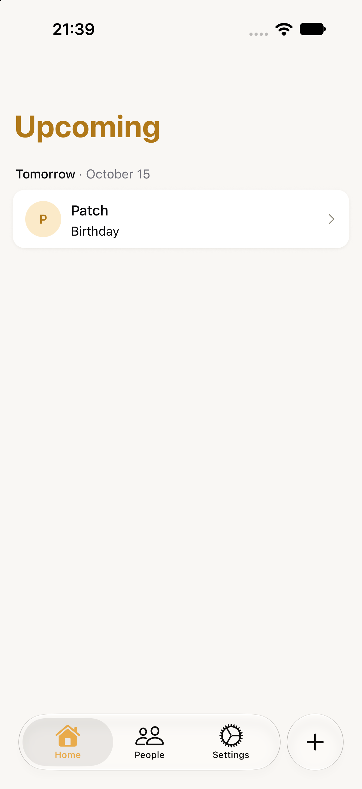

# Expo 57 patch update — October 14, 2026

Updated from freshly fetched `origin/master` at `2cbc753`. Expo is now `57.0.29`, with the latest SDK 57 patches for installed Expo packages, including `@expo/ui 57.0.24`, `expo-router 57.0.27`, and `expo-modules-core 57.0.23`. React Native remains `0.86.3`.

## Native patches and build configuration

- The `react-native-screens 4.26.2` iOS 27 prominent-tab patch is unchanged. The Release build compiled its `shouldSelectTab` and `didSelectTab` callbacks; both symbols were checked in the compiled object.
- The SwiftUI TextField workaround and paired Android camera-recovery patches apply unchanged to their new package versions. Their patch filenames and manifest keys were updated. Installed sources contain all four patches.
- Production EAS builds explicitly select `macos-tahoe-26.6-xcode-27.0`. The resolved profile retains store distribution, remote credentials, auto-increment, and `com.rogeonee.lapsha`. Scene support remains enabled.

## Verification

`bun run check`, the unit suite, the Edmonton/Tokyo date suites, `expo install --check`, and all 21 Expo Doctor checks passed.

A fresh Lab prebuild and arm64 simulator **Release** build succeeded with Xcode 27.0 (`27A266a`). The app contains an embedded Hermes bundle and was launched without Metro. Bundle: `com.rogeonee.lapsha.giftslab`; version: `0.1.0 (1)`.

Executable SHA-256: `78fcb787df9495394f6931181de64595a95ed675fbc97e00c5c8b994086214cc`.

On the existing **iPhone 18 Pro / iOS 27.0** simulator:

- Cold launch rendered Upcoming and the detached Quick add button.
- Created a disposable person through the native Add person screen.
- Opened Quick add from a person screen, entered and saved a labeled fact, and remained on that person screen with the saved fact visible.
- Switched to Settings, opened and dismissed Quick add, and remained on Settings.
- Returned to the preserved People detail stack; tapped People again and returned to its root list.
- Reopened Quick add, switched to Date, selected October 15 in the native date picker, and saved a birthday. Upcoming showed it under Tomorrow.
- Terminated and relaunched the app; the saved birthday remained visible.

On the existing **iPhone 16 / iOS 18.0** simulator, the same binary launched successfully to Upcoming. Coverage was launch-only, as requested. No additional iOS 18 form or keyboard regression testing is claimed.

The user requested ending testing after these build/launch and focused iOS 27 checks. Android device testing is explicitly deferred. This is simulator Release evidence, not an App Store-signed archive or TestFlight installation.

Both pre-existing Lab app binaries and Documents/Library contents were restored; all backed-up files were verified byte-for-byte (24 on iOS 27, 25 on iOS 18). Normal Lapsha installations/data were untouched. Keyboard capture was returned to off and both simulators were shut down.

## Screenshots

