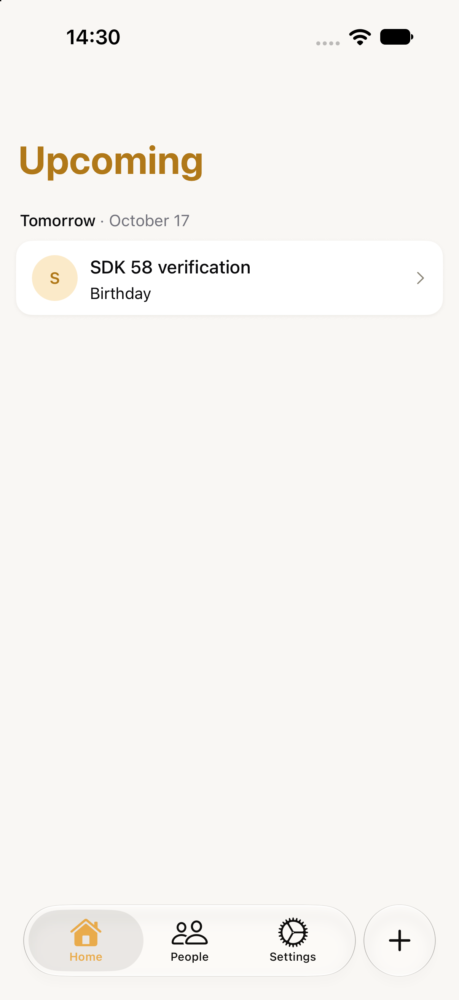
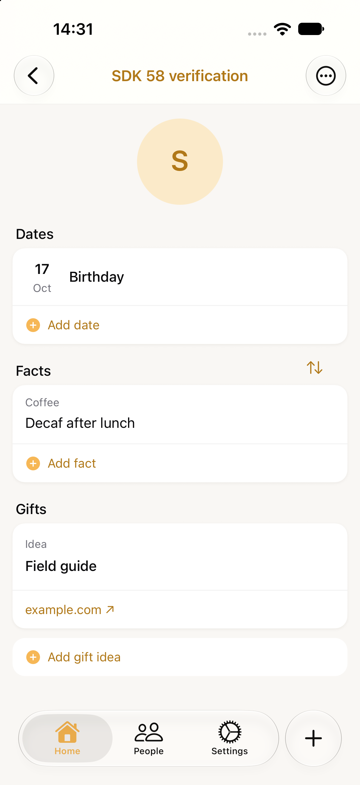
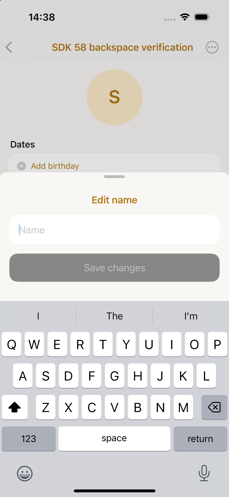

# Expo SDK 58 upgrade — October 16, 2026

Upgraded from the refreshed `origin/master` at `ad9bab1` to Expo `58.0.14`, React Native `0.88.0`, and React `19.3.0`. Installed native packages follow Expo's SDK 58 recommendations. The lockfile contains no SDK 57 packages.

## Patch decisions

Current versions and filenames live in [package.json](../../package.json).

| Patch or workaround                  | Decision and evidence                                                                                                                                                                                                                                                                                                                     |
| ------------------------------------ | ----------------------------------------------------------------------------------------------------------------------------------------------------------------------------------------------------------------------------------------------------------------------------------------------------------------------------------------- |
| iOS prominent tabs in Screens        | Removed the native patch. Screens 4.30 provides the UITab implementation, selection delegates, and prominence API. iOS 27 quick add uses `unstable_nativeProps.ios.prominentScreenKey`; iOS 26 retains the search role. Opening, dismissal, saving, stack preservation, and repeated-tab behavior passed on iOS 27.                       |
| SwiftUI TextField backspace          | Retained and rebased. The SDK 58 selection implementation is unchanged from SDK 57, apart from an unrelated macOS responder change. Selection-enabled fields remain gated to iOS 26+. Held software-keyboard Delete passed in prefilled name, fact, fact-label, and date-label fields on iOS 18.                                          |
| Android activity-result registry     | Retained and rebased. Upstream still does not persist requests before external launch. The patch preserves pre-launch persistence, one-time restoration, and result cleanup alongside SDK 58's new launcher re-registration.                                                                                                              |
| Android ReactActivityDelegateWrapper | Retained and rebased around the changed imports. Results still need to await ReactHost startup outside the lifecycle mutex. Actual process-death confirmation and cancellation passed.                                                                                                                                                    |
| HeroUI input declarations            | Updated HeroUI to 1.0.10 and added a declarations-only patch. Its source uses compatible component refs, but four published declarations still name the legacy TextInput type. They now use TextInputInstance, matching React Native's Strict TypeScript API.                                                                             |
| Bundled asset registry               | Added an expo-asset patch. The release APK's icon-font loading failed with `Cannot read property 'getAssetByID' of undefined` through React Native's public export. Asset and resolveAssetSource now use Metro's shared `react-native/asset-registry` entry point. All three tab states and cold-start rendering passed on the final APK. |
| Scene support opt-in                 | Removed the obsolete flag and the otherwise unused build-properties dependency. SDK 58 generates SceneDelegate and the scene manifest by default. Both iOS runtimes launched successfully.                                                                                                                                                |

## Compatibility changes

- Gift journals and permanent photo copies use `writeSync` and `copySync`, preserving their ordering and synchronous error handling. Existing recovery tests use the same APIs.
- Navigation uses the stable native-tabs entry point, `anchor` settings, and the new removal-prevention `repeat()` callback after clearing prevention.
- Input refs use TextInputInstance; form handlers discard native event arguments. SwiftUI's formerly implicit zero spacing is explicit where needed.
- Removed the direct Babel dependency; retained expo-constants because Router requires it as a direct native peer.
- Updated the Expo lint plugin and React setting after reviewing the SDK 58 lint preset; its enabled rule set is unchanged. EAS quality checks use the SDK 58 image.

These changes follow the [SDK 58 release notes](https://expo.dev/changelog/sdk-58).

## Verification

A fresh frozen-lockfile install applied all five patches. Patched source files matched the build checkout. After replacing the in-place dependency tree and clearing the Expo cache:

- `bun run check`: passed.
- Unit suite: 98 passed; no failures.
- Edmonton and Tokyo date suites: 52 passed in each timezone.
- Expo Doctor: all 20 checks passed.
- `expo install --check`: compatible versions.
- Clean iOS and Android exports: passed.

Fresh Lab native projects produced an arm64 iOS simulator Release app with Xcode 27.0 and an arm64 Android Release APK with R8 enabled. Both run embedded Hermes bundles without Metro. Android used the temporary application ID `com.rogeonee.lapsha.sdk58qa` in generated native output, preserving the existing normal and Lab installations.

### iPhone 18 Pro / iOS 27.0

Created a person, saved a labeled fact, saved an unknown-year birthday through quick add, and saved a gift title/link. Quick add opened from a person and from Settings; saving and dismissal preserved the originating stack. Switching back to People retained its detail screen, and tapping People again returned to the list. Upcoming showed the birthday under Tomorrow, including after a cold restart.

### iPhone 16 / iOS 18.0

Created a person, fact, and date. Held the software keyboard's Delete key for 2.5–3 seconds in prefilled fact, fact-label, date-label, and name fields without a crash. An empty name disabled Save; refilling and saving worked. This was software-keyboard input, not hardware backspace.

### Pixel 6 / Android 17

- Person creation, native birthday selection, an unknown year, labeled-fact creation, swipe deletion, and persistence after restart passed.
- Camera permission denial showed recovery controls; retry reached the camera.
- Normal capture saved a photo. The gift editor's Keep editing, Discard, and Save/Done paths worked; discarding details retained the photo.
- Killed the app process while system-camera confirmation remained open, verified that the process was gone, then confirmed: exactly one gift recovered into Unsorted.
- Repeated process death before cancelling a shuttered capture: Unsorted stayed at one. The next normal capture worked.
- A force-stop/relaunch preserved the birthday, saved gift details, and the single Unsorted gift without replay duplicates.
- After fixing bundled font loading, all three tabs showed their outline/filled icon pairs. The final release APK repeated process-death confirmation and a cold restart: exactly one Unsorted gift, the birthday under Tomorrow, and all tab icons persisted.
- The photo viewer rendered an image, responded to double-tap zoom, and closed. No QA-package fatal runtime crash was recorded.

The generated Android manifest retained CAMERA, omitted RECORD_AUDIO, and retained both custom backup-rule references.

## Cleanup and limits

Original simulator Lab binaries and Documents/Library files were restored; all 23 iOS 27 and 25 iOS 18 saved files matched their backup hashes. Both simulators returned to shutdown, and keyboard capture remained off. The temporary Android QA app and UI-dump file were removed. Normal native projects were regenerated after Lab testing.

At the user’s subsequent request, the tested SDK 58 Lab Release build was reinstalled on both baseline simulators and left installed and running for manual review. Existing Lab data was backed up before the in-place installs. Both installed executables and embedded bundles matched the tested build.

Coverage used default text/display scale. No iOS 26 runtime was installed. Physical iOS, store-signed distribution, VoiceOver/TalkBack, pinch-gesture coverage, scale sweeps, and OS backup/transfer were not verified.

## Screenshots

