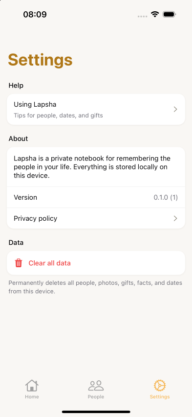
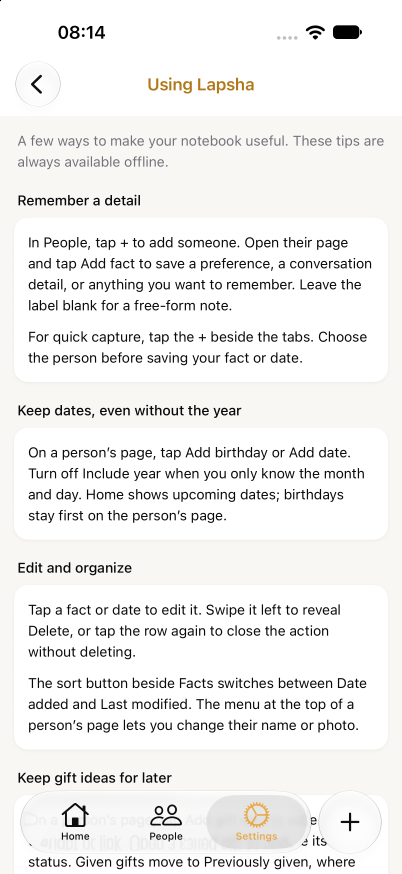
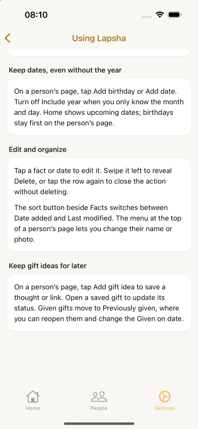
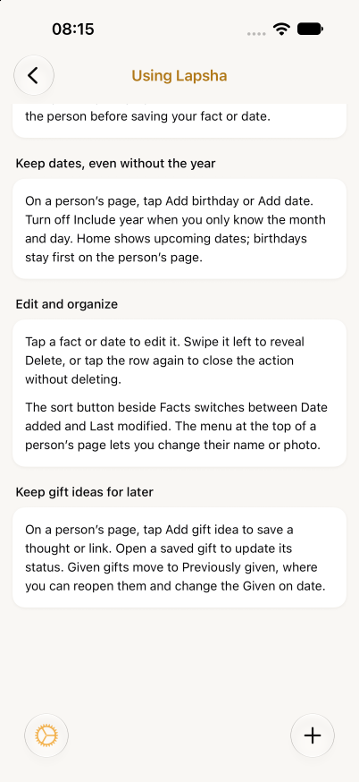

# Settings guide verification — October 15, 2026

Settings now has a **Using Lapsha** entry with bundled tips for existing features.
The beta already supports unlabeled facts, yearless dates, swipe actions, fact
sorting, and gift history, but Settings previously offered no help finding them.
The guide gives these features a discoverable home without adding preferences,
permissions, accounts, or data operations. Quick-add instructions follow the
current platform gate; gift-photo and Unsorted instructions appear only on Android.

## Scope and setup

- Baseline: `8ba1295b6299e106165a39c79321d3cfcb54055b`; branch
  `codex/settings-using-lapsha`. Only Settings route code and this evidence changed.
- Existing iPhone 16 / iOS 18.0 and iPhone 18 Pro / iOS 27.0 simulators, used
  sequentially at their default display/text sizes. No simulator was created.
- Reused the development simulator binary built by the e2e task from the same
  native dependency lockfile. Copied/ad-hoc signed it as
  `com.rogeonee.lapsha.settingsqa`; Metro on port 8092 served this Settings worktree.
  Production and Lab app sandboxes were not read, seeded, cleared, or uninstalled.
- Native executable SHA-256:
  `86fde4065f771ccb4fa699a631d9085c0c94012bf4595d2ee05a2ff6d40fa9b2`.
  Matching Bun lockfile SHA-256:
  `ee8eb844a1aeb7101c6c31353d55a270cb0d6060ea808ed622fb82de5a8ea161`.
- Interactions used the installed `agent-device` 0.21.25 driver, accessible
  labels, settled native snapshots, and inspected screenshots. The e2e task's
  owned-session helper was reused from outside this branch; no shared test
  infrastructure was modified or added here.

## Results

| Flow                                                                                | iOS 18                   | iOS 27                                           |
| ----------------------------------------------------------------------------------- | ------------------------ | ------------------------------------------------ |
| Settings → Using Lapsha, native Back, repeated entry                                | Passed, three entries    | Passed, four entries                             |
| Scroll to the final gift section and read the complete text above navigation chrome | Passed                   | Passed, including collapsed native tabs          |
| Switch Home → Settings while the guide is open; return to guide, then Back          | Passed                   | Passed after expanding the minimized tab bar     |
| Appropriate quick-add instructions                                                  | Correctly absent         | Correctly says “+ beside the tabs”               |
| Android photo/Unsorted instructions absent                                          | Passed                   | Passed                                           |
| Open Quick add from the guide, dismiss without saving, continue scrolling           | Not applicable to iOS 18 | Passed; empty-fixture “Add a person first” sheet |
| Re-enter guide and switch tabs after terminating the owned Metro process            | Not exercised            | Passed with the already-loaded bundle            |

The iOS 27 Home locator initially found no match while the system tab bar was
minimized. Tapping the visible Settings tab expanded it; Home/Settings switching
then passed. This was a driver targeting correction, not an app change.

`bun run check` passed (Oxlint, Oxfmt, Expo type generation, TypeScript), and
`git diff --check` passed. No rendering-only unit tests were added for static copy;
the meaningful verification here is the actual native navigation flow.

## Screenshots

| Entry point                                                                      | Platform-specific guide                                                                             |
| -------------------------------------------------------------------------------- | --------------------------------------------------------------------------------------------------- |
|                  |           |
|  |  |

## Limits and cleanup

Android copy was checked against the current Android implementations; Android
device behavior was not exercised. This is development-client evidence, not a
signed release, update-install, or offline cold-start test. The guide itself
contains bundled text and no network requests. VoiceOver, enlarged text, and
display-zoom matrices were not part of this focused pass.

Both owned sessions reported cleanup with no errors: disposable app removal was
confirmed, each simulator was shut down, the driver/Metro processes stopped, and
temporary keep-awake processes exited. Temporary dependency and e2e-helper
symlinks were removed after verification. Raw local session/provenance/cleanup
logs remain in the task's `verification/ios18` and `verification/ios27` directories.
